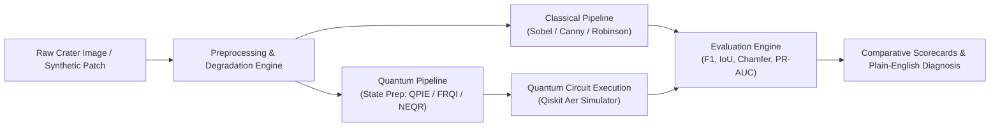

# Quantum & Classical Lunar Edge Detection Visual & Mathematical Research Lab

An interactive, step-by-step visual and mathematical pipeline dashboard built with Streamlit, Qiskit Aer, and OpenCV. The application provides equal depth and mathematical transparency to both **Classical** (Sobel, Canny, Robinson) and **Quantum** (QPIE-QHED, FRQI-QHED, NEQR-Gradient) edge detection algorithms.

---

## 1. System Architecture & Live Data-Flow Tracker



The top strip displays **live tensor state hand-offs** between each pipeline phase:
- **Phase 0:** Raw Input Image $[H \times W]$, $\min/\max$, $\mu$, $\sigma$.
- **Phase 1:** Degraded/Noisy State.
- **Phase 2:** Filtered & Enhanced State.
- **Phase 3:** Quantum State Vector / Classical Gradient Tensor.
- **Phase 4:** Edge Probability Confidence Map.
- **Phase 5:** Final Binary Decision Map $[H \times W]$ at optimal threshold $T^*$.

---

## 2. Multi-Method Processed Results & Intelligent Performance Analysis

A dedicated, prominent comparison section displaying the after-process results on your active image across all 4 methods:

### 2A. Side-by-Side 5-Column Output Gallery
1. **Input Patch:** Raw image, dynamic range, contrast statistics.
2. **FRQI-QHED (Quantum):** Continuous confidence map (Magma), Otsu binary edges, and vibrant Magenta color overlay.
3. **Sobel 3×3 Operator:** Continuous gradient magnitude (Viridis), binary edges, and Cyan color overlay.
4. **Canny 5-Stage Detector:** NMS thinned magnitude (Plasma), hysteresis binary edges, and Yellow color overlay.
5. **Robinson 8-Direction Compass:** Dominant direction map (Twilight 0°–315°), binary edges, and Green color overlay.

### 2B. Automated "Which Is Performing Better & How?" Diagnosis Engine
- **Rankings Podium:** 🥇 1st Place (Champion), 🥈 2nd Place (Runner-up), 🥉 3rd Place, 🏅 4th Place based on composite quality scoring (coverage balance, SNR, boundary thinness, and ground truth F1/IoU).
- **Physical Mechanism Breakdown:**
  - *Why Quantum FRQI Excels:* Destructive quantum interference cancels flat terrain noise ($P(\text{edge}) \propto |I_a - I_b|^2 \to 0$ when $I_a \approx I_b$), avoiding Sobel's thick 3-pixel blur without needing aggressive Gaussian pre-filtering.
  - *Canny Trade-offs:* High boundary thinness via NMS, but Gaussian pre-blurring can shift or erase low-contrast crater rims.
  - *Robinson Strength:* 8-directional compass captures subtle illumination transition arcs, acting as an optimal geological referee.
- **Complete Quantitative Scorecard:** Compares Edge Coverage (%), Active Edge Pixels, Boundary Thinness (%), Edge SNR, Entropy, Qubits, Latency (ms), and Ground Truth benchmark scores.

---

## 3. Live Quantum Gate Execution & Pixel-by-Pixel Reconstruction Engine

A dedicated live execution engine demonstrating how the quantum edge image materializes:
- **Interactive SVG Circuit Diagram:** 6 position qubits wires with bright colors, gates (`Init`, `CCX`, `CX`, `X`, `H`, `Measure`), and a moving glowing dashed cursor tracking the active gate.
- **Automated Pixel-by-Pixel Construction:**
  - Click **`🚀 Build Image Pixel-by-Pixel`**: The quantum circuit evaluates each coordinate basis state $|y\rangle|x\rangle$ sequentially.
  - As Hadamard difference interference calculates $P(\text{edge}) \propto |I_a - I_b|^2$, the corresponding pixel illuminates in the **Live Reconstructed Edge Map** with glowing transitions.
  - Live Telemetry HUD displays active coordinates $(x, y)$, basis state, pixel intensity $I_a$, neighbor intensity $I_b$, difference $\Delta I$, calculated edge probability, and progress percentage.
- **5 Synchronized Visual Fields:**
  1. Input Patch (Active pixel highlighted with golden outline)
  2. Statevector Amplitudes ($\alpha$) across 64 basis states
  3. Live Reconstructing Quantum Edge Map
  4. Sampled Measurement Hits (statistical Aer shots)
  5. Dynamic Otsu Binary Decision Map ($T^*$)
- **Qiskit Circuit & Gate Breakdown:** Matplotlib graphical circuit drawer, ASCII Unicode text drawer, and complete gate sequence table.

---

## 4. Interactive Global Pixel Coordinate Inspector

Users can select any $(x, y)$ coordinate via interactive sliders:
- **Visual Preview:** Renders an image patch with a highlighted $3\times 3$ bounding box at $(x, y)$.
- **Numerical Neighborhood Submatrix:** Renders an exact table of pixel intensities $\begin{bmatrix} I_{00} & I_{01} & I_{02} \\ I_{10} & I_{11} & I_{12} \\ I_{20} & I_{21} & I_{22} \end{bmatrix}$ centered at $(x, y)$ that dynamically updates the mathematical breakdown across all classical and quantum sections.

---

## 5. Phase-by-Phase Preprocessing Inspector

- **3-Stage Visual Progression Strip:** Raw Input $\to$ Degraded State (Gaussian noise, blur, contrast ramp) $\to$ Filtered State (Gaussian, Median, CLAHE, Gamma).
- **Before/After Histograms:** Overlaid intensity distributions highlighting dynamic range expansion and contrast adjustments.
- **Live Local Math:** Shows the analytical transformation formula and step-by-step numerical calculation at selected coordinate $(x, y)$.

---

## 6. Deep-Dive Classical Edge Detection Pipeline

- **Sobel Operator:** Horizontal gradient $G_x$, vertical gradient $G_y$, gradient magnitude $G$, orientation angle $\Theta$, and live $3\times 3$ kernel convolution products at $(x, y)$.
- **Canny Detector:** 5-stage strip, normal angle quantization ($0^\circ, 45^\circ, 90^\circ, 135^\circ$), live NMS neighbor comparison, and dual-threshold hysteresis classification.
- **Robinson Compass:** $2\times 4$ directional response grid ($0^\circ \dots 315^\circ$), dominant orientation map, and live 8-directional response bar chart at $(x, y)$.

---

## 7. Deep-Dive Quantum Edge Detection Pipeline

- **Quantum State Preparation:** Mathematical equations for QPIE (amplitude encoding), FRQI (angle encoding), and NEQR (basis integer register).
- **Live Pixel Encoding Arithmetic:** Computes exact amplitude, rotation angle $\theta_{x,y}$ in radians and degrees, and 8-bit binary register configuration for pixel $(x, y)$.
- **Hadamard Interference Arithmetic:** Demonstrates constructive vs. destructive interference ($P(\text{edge}) \propto |I_a - I_b|^2$).
- **5-Stage Progression:** Circuit resource card, Aer statevector histogram, continuous confidence map, threshold sweep curve ($T^*$), and binary edge map.

---

## 8. Custom Image Upload & Interactive Processing

- **Supported Formats:** PNG, JPEG, WebP, BMP, TIFF.
- **Transformation Modes:**
  - **Resize / Fit to Power-of-Two:** ($4\times 4, 8\times 8, 16\times 16, 32\times 32$) with Area, Linear, or Nearest interpolation.
  - **Region of Interest (ROI) Crop:** Crop window ($4\times 4, 8\times 8, 16\times 16, 32\times 32$) with Center X and Center Y sliders.
- **Optional Ground Truth Mask:** Upload a reference binary mask to compute Exact F1, 1-px F1, 2-px F1, IoU, Chamfer Distance, and PR-AUC.

---

## 9. Running the Dashboard

The dashboard runs locally via Streamlit:
```bash
.\.venv\Scripts\streamlit.exe run dashboard/app.py --server.port 8501 --server.headless true
```
Open **[http://localhost:8501](http://localhost:8501)** in any modern web browser.
